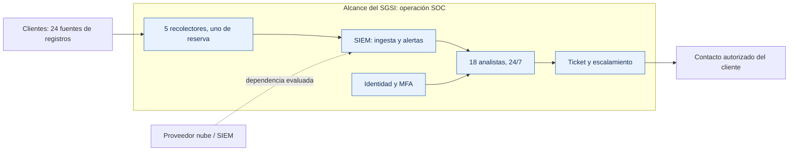
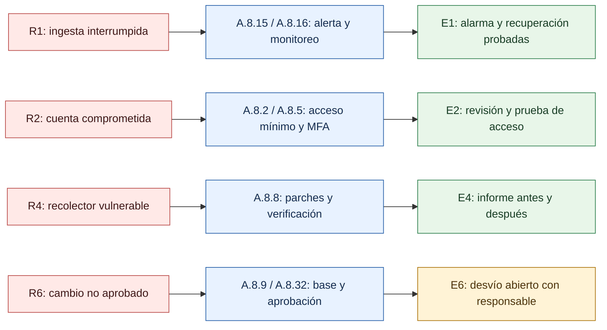

# Caso ficticio: SGSI de un SOC

> **Simulación educativa · 11-10-2026.** «Centinela Sur» no existe. Las personas, métricas, pruebas y evidencias de esta página son inventadas. No representa una empresa certificada ni una auditoría real.

## 1. La empresa y el alcance

Centinela Sur presta monitoreo de seguridad **24/7** a seis clientes con 18 analistas. El alcance simulado del SGSI es la **operación del SOC**: recepción de registros, plataforma SIEM, análisis de alertas, gestión de identidades del equipo y escalamiento de incidentes. Administra 24 fuentes de registros y cinco recolectores. Conserva registros durante 30 días según contratos ficticios.

Las aplicaciones y redes de producción de los clientes, y la nómina corporativa, quedan fuera de este alcance. El proveedor de nube del SIEM y el proveedor de identidad son **dependencias que se evalúan**, aunque su infraestructura no la opere el SOC.

## 2. Cómo se valoran los riesgos

La **probabilidad** y el **impacto** usan 1 (bajo), 2 (medio) y 3 (alto); se multiplican. **1–2** es bajo, **3–4** medio y **6–9** alto. El residual se estima después del tratamiento. Para este ejemplo, la responsable del SOC acepta riesgos de hasta **4** si hay seguimiento y fecha de revisión; los altos requieren tratamiento adicional.

**Tablero simulado al 11-10-2026:** 🟢 5 riesgos con prueba realizada · 🟡 1 mejora pendiente · 🔴 0 riesgos residuales altos.

| Riesgo dentro del alcance | Inicial → residual | Tratamiento y controles de apoyo | Estado simulado |
|---|---:|---|---|
| **R1. Se corta la ingesta** y no se detecta un incidente | 9 → 3 | Alerta por fuente silenciosa, recolector de reserva y prueba de conmutación. **A.8.15, A.8.16, A.8.14** | 🟢 Probado |
| **R2. Se usa una cuenta de analista ajena** | 6 → 3 | MFA, privilegio mínimo, baja inmediata y revisión de accesos. **A.5.16, A.5.18, A.8.2, A.8.5** | 🟢 Probado |
| **R3. Se exponen registros de un cliente a otro** | 6 → 3 | Separación por cliente, minimización y regla DLP para exportaciones. **A.5.34, A.8.3, A.8.12** | 🟢 Probado |
| **R4. Un recolector vulnerable queda sin parche** | 6 → 3 | Inventario, plazo de remediación y nueva comprobación. **A.5.9, A.8.8** | 🟢 Probado |
| **R5. Un incidente crítico se escala tarde** | 6 → 3 | Guion de respuesta, suplente, formación y simulacro. **A.5.24–A.5.26, A.6.3** | 🟢 Probado |
| **R6. Una regla SIEM cambia sin aprobación** | 6 → 4 | Línea base, ticket, revisión y reversión. **A.8.9, A.8.32** | 🟡 Mejora abierta |

## 3. Evidencia simulada y decisión

Cada dato siguiente es **una muestra ficticia** de qué verificar. No hay capturas, reportes de producto ni certificados reales asociados a estos códigos.

| Código | Comprobación del ejemplo | Resultado ficticio |
|---|---|---|
| **E1** | Silenciar una fuente de prueba y conmutar al recolector de reserva | Alarma en 3 min; ingesta recuperada en 28 min; 24/24 fuentes visibles después |
| **E2** | Revisar cuentas y probar acceso sin MFA | 18/18 analistas con MFA; acceso de prueba rechazado; revisión firmada por la responsable |
| **E3** | Intentar consultar y exportar un registro de otro cliente con cuenta de prueba | Consulta denegada; exportación de dato marcado bloqueada; evento registrado |
| **E4** | Comparar reporte de vulnerabilidades antes y después de la ventana de parcheo | 5/5 recolectores actualizados; vulnerabilidad de prueba ya no aparece en el nuevo reporte |
| **E5** | Ejecutar simulacro de incidente crítico | Escalamiento en 12 min frente al objetivo interno de 15 min |
| **E6** | Comparar regla SIEM con línea base y ticket aprobado | Una diferencia sin ticket: cambio revertido; revisión de permisos pendiente al 15-11-2026 |

**Decisión simulada:** la responsable acepta temporalmente el residual **4** de R6 hasta el **15-11-2026**, con revisión semanal. Los otros cinco riesgos residuales quedan en **3** y se revisan cada trimestre. Si una prueba falla, se actualiza el riesgo y se abre una acción correctiva; una herramienta instalada por sí sola no equivale a un control eficaz.

## Para adaptar el caso

Reemplaza el alcance, los activos, contratos, escalas, objetivos y evidencias por los de tu organización. Selecciona controles según tus riesgos; la tabla muestra **solo controles vinculados a estos seis riesgos**, no una evaluación de los 93 ni una declaración de aplicabilidad. La [guía de herramientas del repositorio](../herramientas-vs-manual-iso-27002.md) ofrece opciones, pero su compra no prueba cumplimiento.

**Referencias:** [ISO/IEC 27001:2022](https://www.iso.org/standard/27001) · [ISO/IEC 27005:2022](https://www.iso.org/standard/80585) · [diagramas Mermaid en GitHub](https://docs.github.com/es/get-started/writing-on-github/working-with-advanced-formatting/creating-diagrams).
