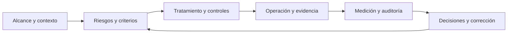

# Implementar y mantener un SGSI con ISO/IEC 27001:2022

**Ruta práctica.** Empieza por el alcance y los riesgos; después decide y opera controles; finalmente comprueba resultados y corrige. Puedes usarla sin buscar una certificación. Para certificarte, consulta el texto oficial de la norma y trabaja con un organismo de certificación competente. Esta guía no reproduce sus requisitos completos.

> **Idea central:** un SGSI funciona cuando una decisión sobre un riesgo llega a una acción, esa acción deja evidencia y alguien revisa si produjo el resultado esperado. Una política aprobada o una herramienta instalada son solo partes de esa cadena.



## 1. Construye la primera versión

Trabaja en este orden. Cada resultado debe tener **responsable, fecha y versión**; guarda también las decisiones que descartan una opción.

| Paso | Qué hacer | Resultado que debe quedar |
|---|---|---|
| **1. Delimita el SGSI** | Define servicios, procesos, información, personas, lugares y sistemas dentro del alcance. Dibuja límites, flujos y dependencias con otras áreas y proveedores. Identifica partes interesadas y requisitos relevantes. | Alcance escrito que otra persona pueda aplicar sin adivinar qué está incluido. |
| **2. Consigue dirección y responsables** | Asegura patrocinio y recursos. Aprueba la política, asigna propietarios de riesgos y controles, y fija objetivos de seguridad que puedas medir. Comunica a las personas lo que deben hacer. | Política aprobada, responsables conocidos, objetivos y forma de medirlos. |
| **3. Define cómo evaluar riesgos** | Establece criterios de impacto, probabilidad y aceptación. Identifica escenarios sobre procesos e información del alcance; registra consecuencias, controles existentes, nivel actual y propietario. Usa siempre el mismo criterio para que dos evaluadores puedan explicar sus diferencias. | Método y registro de riesgos que se puedan repetir y revisar. |
| **4. Decide el tratamiento** | Para cada riesgo que requiera acción, elige reducirlo, evitarlo, compartirlo o aceptarlo según tus criterios. Asigna acción, dueño, plazo, recursos y riesgo esperado tras tratarlo; registra quién aprueba la aceptación. | Plan de tratamiento con decisiones y plazos, no solo una lista de riesgos. |
| **5. Selecciona controles y crea la SoA** | Deriva los controles necesarios del tratamiento y de otros requisitos aplicables. Compáralos con el Anexo A; justifica los incluidos y los excluidos, indica cuáles están implementados y conserva la relación con los riesgos. | Declaración de Aplicabilidad (SoA) coherente con alcance y decisiones. |
| **6. Ponlos a funcionar** | Convierte cada control elegido en una práctica: quién actúa, cuándo, sobre qué población, qué hacer ante excepciones y qué registro genera. Forma a quienes la operan y controla los servicios externos relevantes. | Práctica operativa y evidencia fechada. Ejemplo: no solo programar respaldos; probar una restauración. |
| **7. Comprueba y audita** | Mide objetivos y efectividad; revisa muestras reales. Planifica una auditoría interna de los requisitos del SGSI y controles aplicables, preservando objetividad e imparcialidad. Lleva resultados, riesgos y cambios a revisión por la dirección. | Mediciones, pruebas, informe de auditoría y decisiones de dirección. |
| **8. Corrige y vuelve a evaluar** | Ante fallos o cambios, contiene el problema, investiga su causa, define acciones con dueño y plazo, y comprueba que funcionaron. Actualiza riesgo, tratamiento, SoA y documentación cuando corresponda. | Acciones correctivas cerradas con verificación de efectividad. |

Los **requisitos de las cláusulas 4 a 10** corresponden al sistema de gestión; el **Anexo A sirve de referencia para comprobar la selección de controles**, no como una orden de implantar los 93 sin analizar riesgos. Si un proveedor ejecuta una medida, documenta qué parte hace, cómo la supervisas y cómo comprobarás el resultado: externalizar no elimina la necesidad de gestionarla. [Nota de prácticas de auditoría ISO/IEC sobre la SoA](https://committee.iso.org/files/live/sites/jtc1sc27/files/resources/ISO-IECJTC1-SC27-WG1_N3298_Auditing%20Practices%20Note%20-%20SoA.pdf).

**Contexto vigente:** la [enmienda de 2024](https://www.iso.org/standard/88435.html) pide considerar si el cambio climático es relevante para los resultados del SGSI. Registra la decisión y su fundamento dentro del análisis de contexto; no presupongas que obliga a implantar un control climático.

## 2. Comprueba que la primera versión funciona

Elige un riesgo importante y recorre la cadena completa:

```text
Proceso o información → escenario de riesgo → decisión de tratamiento
→ control y responsable → actividad realizada → evidencia → prueba del resultado
→ riesgo actualizado o acción correctiva
```

Si un eslabón no puede explicarse o demostrarse, vuelve al paso correspondiente. Para evaluar un control, combina **documentos, conversación con quien lo opera y una prueba** cuando sea posible; una captura de pantalla sin contexto no demuestra efectividad. [NIST SP 800-53A Rev. 5](https://csrc.nist.gov/pubs/sp/800/53/a/r5/final) ofrece esa distinción metodológica, aunque pertenece a otro marco.

Tres ejemplos de pruebas útiles:

| Control | Actividad que puedes comprobar | Evidencia más convincente que una política |
|---|---|---|
| **A.5.18 Derechos de acceso** | Elige una baja o cambio de rol autorizado y verifica permisos en los sistemas afectados. | Solicitud, aprobación, cambio aplicado y comprobación posterior. |
| **A.8.8 Vulnerabilidades técnicas** | Sigue un hallazgo priorizado hasta su corrección o aceptación y vuelve a analizarlo. | Hallazgo inicial, decisión, acción y resultado de la nueva comprobación. |
| **A.8.13 Copias de seguridad** | Restaura una muestra y verifica integridad y tiempo de recuperación. | Registro de la restauración, resultado y acción ante errores. |

Define la muestra y la frecuencia según riesgo, cambios y criticidad; **estos ejemplos no fijan una periodicidad exigida por ISO**.

## 3. Mantenlo después del arranque

Un recordatorio ayuda a no olvidar revisiones. El mantenimiento también necesita decidir qué cambió y si los controles siguen funcionando.

| Cuándo revisar | Pregunta que debe responder el responsable | Qué actualizar si la respuesta cambió |
|---|---|---|
| **Al cambiar un servicio, activo, proveedor, contrato o requisito** | ¿Cambió el alcance, una dependencia o un escenario de riesgo? | Inventario, contexto, riesgos, tratamiento, SoA y controles afectados. |
| **En el ciclo operativo definido por la organización** | ¿Se ejecutaron controles y vencen políticas, excepciones o evidencias? | Registros de operación, versiones de políticas, tareas y acciones pendientes. |
| **En los intervalos de medición y auditoría planificados** | ¿Los objetivos avanzan y las pruebas muestran que los controles sirven? ¿La auditoría cubre el SGSI? | Indicadores, pruebas, programa e informe de auditoría. |
| **En la revisión por la dirección** | ¿Siguen siendo adecuados alcance, recursos, riesgos, objetivos y decisiones previas? | Decisiones, responsables, recursos y cambios acordados. |
| **Tras un incidente o una no conformidad** | ¿Qué falló, por qué y cómo sabemos que la corrección evitó repetirlo? | Riesgo, control, acción correctiva y prueba de efectividad. |

**No existe un calendario universal para todas las políticas o controles.** Establece frecuencias propias según riesgos y requisitos aplicables, y revisa también cuando ocurra un cambio relevante. Una plataforma como CISO Assistant puede llevar fechas y avisos; el propietario conserva la decisión y la comprobación de resultados.

**Si buscas certificación:** presenta un SGSI que ya opere y tenga auditoría interna, revisión de dirección y acciones de mejora. Consulta a un organismo de certificación, preferentemente acreditado, sobre auditoría inicial y seguimiento; el seguimiento externo no sustituye este ciclo interno. [ISO: certificación y acreditación](https://www.iso.org/standard/27001).

## 4. Usa los materiales del repositorio

| Necesidad | Punto de partida |
|---|---|
| Política y responsabilidades | [Plantilla de política](../../plantillas/politica-seguridad-informacion.md) |
| Criterios y evaluación de riesgos | [Método de riesgos](../../riesgo/README.md) y [registro CSV](../../plantillas/registro-riesgos.csv) |
| Selección de controles | [Plantilla de SoA](../../plantillas/declaracion-aplicabilidad-soa.md) — sustituye sus ejemplos; no copies estados «implementado» sin verificarlos. |
| Apoyo tecnológico | [Herramientas por control](herramientas-vs-manual-iso-27002.md) y [herramientas para gestionar el SGSI](herramientas-transversales-sgsi.md) |

**Referencia:** [ISO/IEC 27001:2022](https://www.iso.org/standard/27001) define el SGSI; [ISO/IEC 27005:2022](https://www.iso.org/standard/80585.html) ayuda a gestionar sus riesgos; [ISO/IEC 27004](https://www.iso.org/standard/64120.html) orienta la medición de desempeño y efectividad. Las guías y plantillas de este repositorio deben adaptarse a la organización y contrastarse con la norma oficial.
